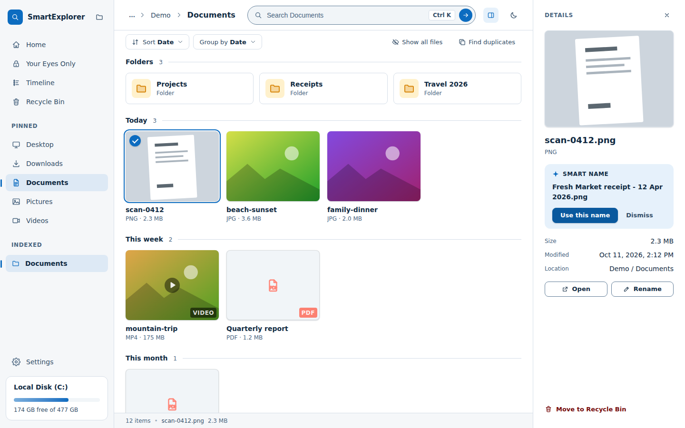
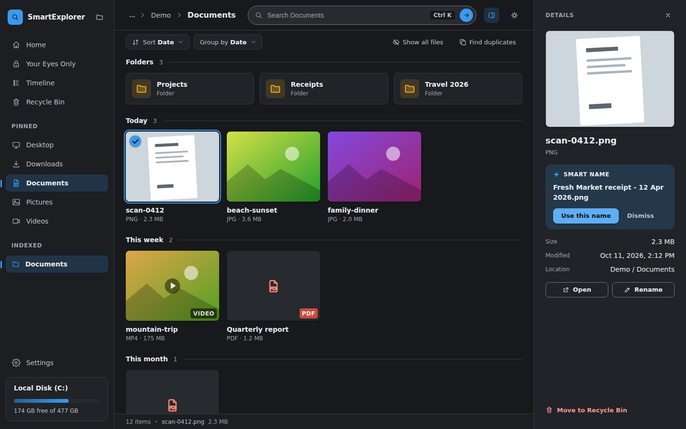
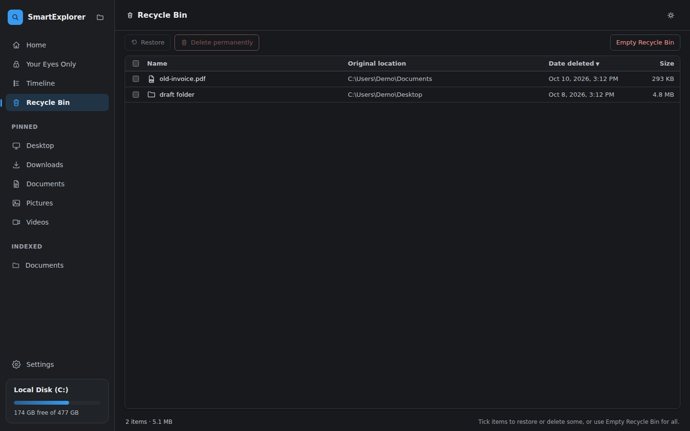
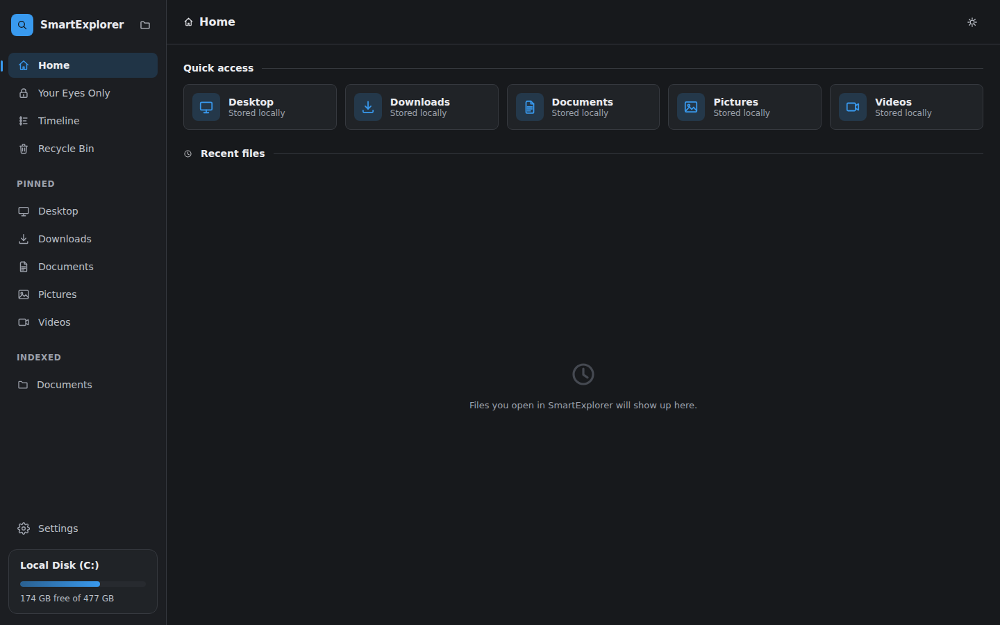
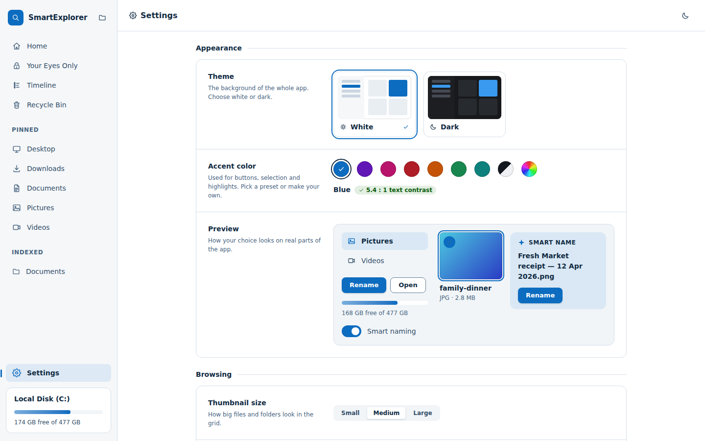
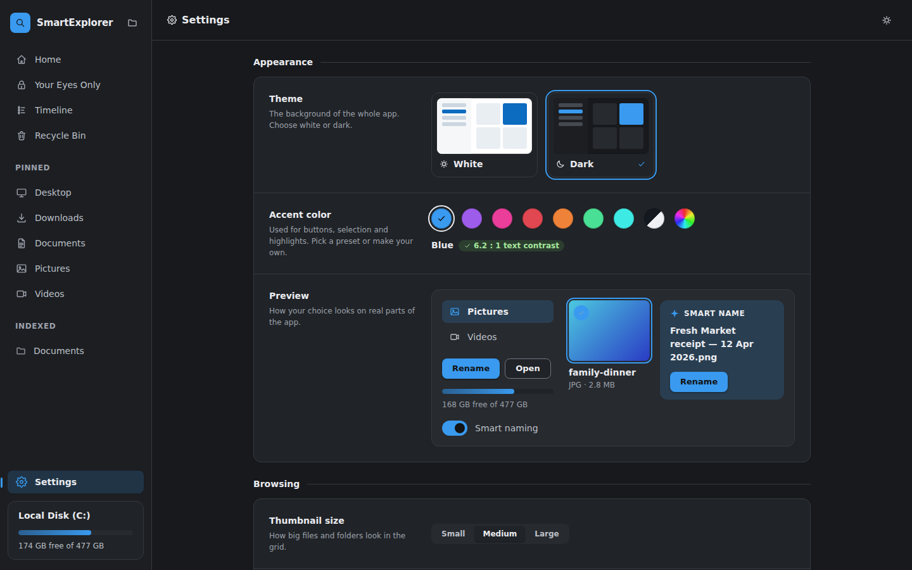

# SmartExplorer

A standalone desktop file browser that can search *inside* your files - by
keyword in documents, OCR'd text in images, and what a photo actually shows
(search "bag" and get back a photo of a bag, even if it's named
`IMG_6154.jpeg` and has no text in it). Videos play a silent 15-second
preview the instant you hover over them.

## Download

Get the Windows installer from the
[Releases page](https://github.com/emperoribk/smartexplorer/releases/latest).
It bundles its own Python engine and the photo-search model, so it works
offline. The exact size is shown on each release. The installer is not stored
in this repository, which holds the source code.

This is the Windows-first build. The same codebase is meant to become a Mac
build later, since Electron and Python are both cross-platform.

## Screenshots

| Light | Dark |
| --- | --- |
|  |  |
|  |  |
|  |  |

(Screenshots use demo data.)

## Features

- **Search inside files**: keywords in documents, OCR'd text in images, and
  what a photo shows (CLIP), all computed locally.
- **Fast folder browsing** with a grid, breadcrumbs, Quick Look preview
  (Space), rename, copy/cut/paste, ZIP and extract.
- **Home** dashboard with quick access and recent files.
- **Timeline**: every indexed file in one newest-first scroll, plus gentle
  "Memories" reminders about folders you haven't touched in a while.
- **Recycle Bin** (Windows): list what you deleted, restore it, or delete
  some or all of it permanently, always behind a confirmation.
- **Your Eyes Only**: an encrypted vault for sensitive files, protected by
  your Windows password or a 5-digit PIN. Only files you send there yourself
  are kept in it; nothing is moved automatically.
- **Find duplicates** and a **storage** view of what is using disk space.
- **Details panel**: select a file to see a preview, size, date and location,
  with a one-click **Smart name** suggestion for scanned documents and images.
- **Sort and Group by** chips in the toolbar, and **Ctrl+K** to jump to search.
- Clean white and dark themes, with a **Settings** page to pick your accent
  colour (presets or a custom hue; button text always stays readable),
  thumbnail size, and whether file extensions are shown.

## Using it

Install it, open it, and start typing. The first time it runs it quietly
indexes your Documents, Pictures, Desktop, Downloads and Videos in the
background (a progress card shows in the sidebar; turn it off under
Settings > Indexing). After that:

- **Search the open folder** from the search box (or press **Ctrl+K**). Try
  words from inside a document, text that appears in a screenshot, or
  something a photo shows, like "brown bag" or "dog on a beach".
- **Press Space on a file** for an instant preview.
- **Your Eyes Only**: send a file or folder there yourself and it is
  encrypted. You protect it with your Windows password or a 5-digit PIN of
  your own, and opening a locked file asks for it again. Locked files and
  folders open inside the app.

Windows shows a "Windows protected your PC" (SmartScreen) warning when you
run the installer, because it isn't code-signed yet. Choose **More info**,
then **Run anyway**.

## License

MIT - see [LICENSE](LICENSE).
